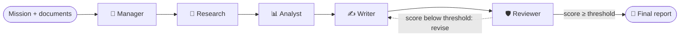

<div align="center">

# 🧠 Nexus AI

### A swarm of five AI agents that plan, research, analyse, write and review, then fix their own weak drafts.


-111111)


**Private · Self-correcting · Ready for real-world impact**

</div>

<!-- Add a screenshot or GIF of the live swarm graph here:
 -->

---

## ✨ Why Nexus AI?

Good planning needs several specialists: a researcher, an analyst, a writer and a reviewer. Small teams and public-interest builders rarely have all of them. Most AI tools give **one unchecked answer** and send your data to someone else's cloud.

Nexus AI gives you the whole team:

- 🧭 **Five specialised agents** that hand work to each other in a pipeline.
- 🛡️ **A quality gate**: if the Reviewer scores a draft too low, it goes back to the Writer and is re-checked before you see it.
- 🔎 **Honest by design**: claims are tagged, and numbers that appear in no source are flagged.
- 🔒 **Private**: runs on your own [Ollama](https://ollama.com), so your data stays with you.
- 🎬 **Demo-proof**: a built-in offline demo mode, so it works with no Wi-Fi and no model.

## 🤖 The agents

| Agent | Codename | Job |
|---|---|---|
| 🧭 Manager | Nexus-Director | Breaks the mission into steps, writes a brief for each agent, flags risks |
| 🔎 Research | DeepSource-Atlas | Gathers evidence, rates confidence, lists what couldn't be verified |
| 📊 Analyst | QuantMetric-V | Runs the numbers, scenarios and sensitivities, and shows the math |
| ✍️ Writer | LexiCraft-Pro | Turns everything into a structured, readable report |
| 🛡️ Reviewer | Sentrix-Audit | Audits facts, logic and clarity, then scores the draft out of 100 |

Every agent has a library of **switchable skills** (Risk Register, West Africa Context, Scenario Analysis, FAQ Section, and more). You can also add your own in about a minute on the **Agents & Skills** page.

## 🔁 How it works



1. You describe a **mission** (or pick a preset) and optionally attach documents and context.
2. Each agent runs in turn, seeing everything the earlier agents produced.
3. The Reviewer scores the draft. Below the threshold (default **85**), the Writer revises using the feedback and the Reviewer re-checks.
4. You get the final report, every agent's output, analytics, and a one-click export.

## 🔎 Reducing hallucination

No LLM tool can promise zero hallucination, so Nexus AI makes the risk visible:

- **Grounding rules**: every claim is tagged `[DOC]`, `[MISSION]`, `[ASSUMPTION]` or `[UNVERIFIED]`, and agents must write "Unknown" instead of guessing.
- **Number audit**: a plain-Python check lists numbers in the final report that appear in no source. The Reviewer receives the list, and the report screen shows a warning.
- **Low default temperature** (0.2).
- **Your own documents**: attach real reports or data and the `[DOC]` tag becomes meaningful.

A human should still confirm important facts before using the output. Calculated figures may also be flagged, so treat the list as "check these", not "these are wrong".

## 🌍 Built for local impact

Preset missions are framed for The Gambia and West Africa, with a **West Africa Context** skill covering low bandwidth, SMS and USSD, mobile money and informal markets:

- 🩸 Blood-donation coordination system
- 🏥 Hospital queue digitisation for basic phones
- 🔧 Auto spare-parts marketplace

General business presets are included too (semiconductor roadmap, SaaS unit economics, Zero-Trust migration).

## 🚀 Quick start

### 1. Install

```bash
git clone https://github.com/<your-username>/nexus-ai.git
cd nexus-ai
pip install -r requirements.txt
```

### 2. Run in demo mode (no model needed)

```bash
streamlit run app.py
```

Click **🎬 One-click demo**. It runs a full mission offline with sample output.

### 3. Run with a real model

Install [Ollama](https://ollama.com), then:

```bash
ollama serve                      # leave this running
ollama signin                     # needed for the cloud model
ollama pull gemma4:31b-cloud
streamlit run app.py
```

The status chip at the top should show **● Ollama online**. You can pick any installed model in **Settings**.

> **Tip:** Ollama is a separate program, not a Python package, so it is not in `requirements.txt`.

## 📄 Exports

Download any run as **Word (.docx)**, **PDF**, **HTML**, **Markdown**, **plain text** or **JSON**, as the final report only or the full run (every agent and the skills used). You can also build a **ZIP** of all formats.

## 🗂️ Project structure

```
nexus-ai/
├── app.py            # Streamlit app: agents, skills, swarm engine, pages
├── exports.py        # Word / PDF / HTML / Markdown / text / JSON / ZIP export
├── requirements.txt
├── runs/             # saved runs (created automatically, git-ignored)
└── README.md
```

## ⚙️ Settings

| Setting | What it does |
|---|---|
| Ollama base URL | Where your model server lives (default `http://localhost:11434`) |
| Model | Used by all agents |
| Output depth | Brief, Standard or Deep |
| Output language | English, Français, Português, Español, Kiswahili |
| Temperature | Default 0.2 for fewer invented details |
| Quality gate | Turn auto-revise on or off and set the score threshold |

Set `NEXUS_DEMO_FAST=1` to skip the typing delay in demo mode while testing.

## 🛠️ Tech stack

Streamlit · Ollama · Python · Graphviz (swarm graph) · python-docx · ReportLab · pandas

## 🗺️ Roadmap

- [ ] Team database and shared workspaces
- [ ] Local-language output and voice input
- [ ] Live web search and spreadsheet tools for the Research and Analyst agents
- [ ] Shared skill libraries across teams

## ⚠️ Notes

- Scores and figures in **demo mode** are illustrative sample output, not real analysis.
- Output quality depends on the model you use. Bigger models hallucinate less.
- Uploaded documents are treated as reference data, not instructions.

## 👥 Team

<!-- Add your team name and members here -->

## 📜 License

<!-- Add a license, for example MIT -->
